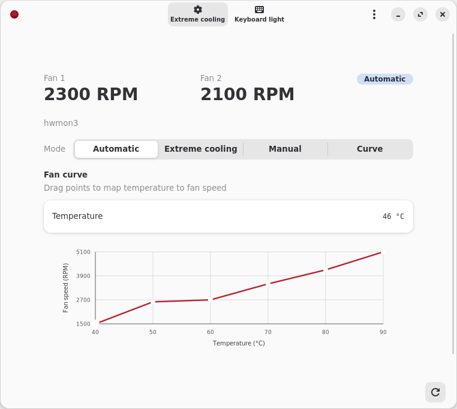
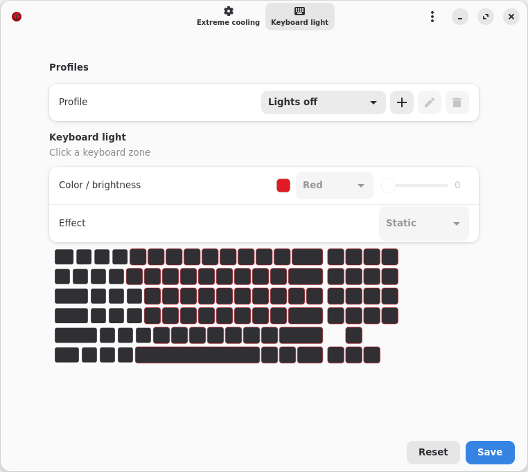

# Y720 Nerve Linux

[中文 README](README.zh-CN.md)

Linux fan control, function-key support, and four-zone backlight tools for the Lenovo Y720-15IKB, version 0.1.1.
Supported hardware is limited to LENOVO 80Y4 / Y720-15IKB / BIOS 4GCN38WW / x86_64.

This project was completed with the assistance of AI.

## Features and design

- `y720_cooling`: keeps the factory auto/boost modes and provides linked control through standard hwmon; custom curves are executed by Linux thermal's `step_wise` governor.
- `y720_hid`: adds missing function-key events.
- `y720-fan` and `y720-backlight`: two independent CLI tools.
- `y720-control`: a GTK4/libadwaita GUI that calls the CLI asynchronously and handles configuration, status, and shortcuts. It does not access hardware ports directly and is not a curve daemon.

Both fans share one target from 1500 to 5100 RPM. They cannot be controlled independently or stopped.
`pwm1` is a normalized request, not an electrical duty cycle. External hwmon tools such as fancontrol and CoolerControl can control the device independently; writing an hwmon target directly releases kernel curve control, so do not run another controller at the same time.

The curve uses one kernel control temperature read directly from Linux thermal's `x86_pkg_temp`.
It comes from the CPU package, not the highest temperature in the system, and is not guaranteed to represent a discrete GPU under a separate heavy load.
No userspace sampling service is required. The project does not call NVIDIA tools or read discrete-GPU power state.
The curve may request 5100 RPM at any time; overheating is not a prerequisite. If the control temperature is unavailable or communication fails, the driver keeps the last target, reports the error, and retries. It does not automatically switch to auto/boost or force a fixed full-speed fallback. Unload, shutdown, and suspend hand control back to firmware auto; after resume, the previous curve is restored. Recovery is not guaranteed if the hardware disappears or the kernel crashes.

The backlight is controlled from userspace through an independent hidraw interface, with a fixed palette, five effects, and four-zone brightness.
The hardware does not provide reliable color or brightness readback, so a submitted or saved profile does not represent confirmed hardware state.

## Screenshots





## Installation and removal

Build as a regular user first. The GUI requires GTK 4.16+ and libadwaita 1.7+; modules must be built with headers and toolchains matching the running kernel.

```sh
# Debian 13
sudo apt install build-essential meson ninja-build pkg-config python3 dpkg-dev \
  libgtk-4-dev libadwaita-1-dev libjson-glib-dev libgdk-pixbuf-2.0-dev \
  libx11-dev dkms
make
make gui
sudo ./install.sh
```

The source install prefix defaults to `/usr/local`; `--cli`, `--gui`, and `--drivers` can be selected.
When using a custom prefix, use it for both the build and installation, for example `make gui PREFIX=/opt/y720` and `sudo ./install.sh --prefix /opt/y720`. Installation does not load modules, take over hardware, or enable startup control automatically; the HID alias may bind automatically when the device appears.

```sh
./scripts/build-debs.sh
sudo apt install ./dist/y720-control_*.deb ./dist/y720-cooling-dkms_*.deb ./dist/y720-hid-dkms_*.deb
```

Building on the target distribution is recommended.

To remove a source installation, select auto first, then run `sudo ./uninstall.sh --all`, or remove individual components. The uninstaller preserves personal configuration and refuses to delete modified or unidentified files. Remove Debian packages with apt; do not use both methods to manage the same files. Before a source upgrade, use the old uninstaller to remove the old files.

## Usage

```sh
sudo modprobe y720_cooling                 # read-only by default
# If already loaded, unload it safely before enabling control; repeating modprobe does not change parameters
sudo modprobe -r y720_cooling
sudo modprobe y720_cooling allow_control=1
y720-fan --json status
sudo y720-fan mode auto
sudo y720-fan mode boost
sudo y720-fan set --rpm 4000
printf '1500 1800 2400 3200 4200 5100\n' | sudo y720-fan curve apply -
y720-control
y720-backlight --json status
sudo y720-backlight set --colors red blue green white --levels 0 1 2 3
```

Curves require `CONFIG_THERMAL_GOV_STEP_WISE` and a valid temperature source. An older module does not gain the new interface merely because its version number matches; see the [CLI manual](docs/CLI.md).

A complete GUI installation grants only the sudo/wheel administrator groups passwordless `sudo -n` access to fixed CLI commands. It does not allow arbitrary shells, file paths, or ordinary non-administrator users. The GUI always runs as the regular user.
The dedicated backlight and input nodes use uaccess permissions from the active desktop session; key reading is not guaranteed over SSH, from an inactive session, or without logind. There is no need to add the user to the entire `input` group or open every hidraw device.

## Function keys

| Key | Handling |
|---|---|
| Fn+F4 / F6 / F8 | Adds microphone mute, touchpad toggle, and camera-privacy events |
| Fn+Space | `KEY_KBDILLUMTOGGLE`; backlight switching is handled in userspace |
| Numpad 7 with NumLock off | `KEY_PROG1`; when the GUI is resident, shows the window without hiding it or switching profiles |
| Numpad 8 / 9 / / with NumLock off | Standard HID play/pause, previous-track, and next-track mappings |
| F22 record key without modifiers | `KEY_RECORD`; `map_record=0` disables it, while modified presses remain F22 |
| Fn+F7 | Synthesizes a flight-mode event when `radio_zero_pulse=1`; disabled by default |

The numpad function layer does not require Fn; volume, brightness, and other standard keys use the kernel's generic path.
Recognizing an event does not mean that the desktop has an action configured for it, and the camera function cannot be verified while the camera is physically disconnected.
The default Ctrl+Shift+main-keyboard 0 shortcut switches auto/boost, and Fn+Space switches backlight profiles; existing custom settings are preserved.
After the GUI exits completely, users may bind the launch key to `y720-control` themselves; the project does not rewrite desktop shortcuts or add a root service.

Ordinary combinations use XGrabKey on X11 and the [GlobalShortcuts Portal](https://flatpak.github.io/xdg-desktop-portal/docs/doc-org.freedesktop.portal.GlobalShortcuts.html) on Wayland.
Wayland requires `xdg-desktop-portal` and a desktop backend that implements this interface; the first activation may require approval in a desktop dialog.
The settings page shows the authorization result and the combination actually assigned by the desktop; the saved combination is only a preferred request.
Unauthorized or unsupported desktops report the reason instead of pretending to provide global support through XWayland; old `keycode:` settings must be recorded again.
Fn+Space and the numpad launch key use the dedicated evdev node in both session types and keep the same permission requirements.

Global shortcuts require the GUI to be running. If the desktop has no such Portal, bind either
`gapplication action org.y720.Control fan-toggle` or
`gapplication action org.y720.Control light-next` in the desktop's shortcut settings to control the running GUI.

See the [development notes](docs/DEVELOPMENT.md) for enabling, limitations, and rollback of Fn+F7, as well as the optional narrow GameZone fix.

## Verification and licensing

`make test` covers pure functions, the simulated CLI, GUI lifecycle, and isolated installation without writing real hardware.
Shortcut regression tests cover Portal authorization, cancellation, service loss, duplicate events, and exit cleanup; simulated tests do not replace actual key testing on each desktop.
There is also an explicitly loaded Linux thermal integration-test module that does not connect to a real fan.
Low, medium, and high setpoints and standard hwmon control have been verified. Unmodified fancontrol 3.6.2 and CoolerControl 5.0.1 have run real temperature curves without a dedicated plugin. The single-temperature design does not require NVIDIA libraries or a sampling service; the actual verification scope is the one documented for this version. Long-duration full-load, real suspend, and complete controlled heat-up/cool-down regressions remain incomplete.

The kernel drivers and related C tests are GPL-2.0-only; the CLI, GUI, scripts, and documentation are MIT unless stated otherwise.
Per-file SPDX identifiers, copyright notices, and the upstream GameZone attribution are retained; see [LICENSE](LICENSE).
The repository does not distribute Lenovo Windows drivers, BIOS images, or proprietary firmware.
