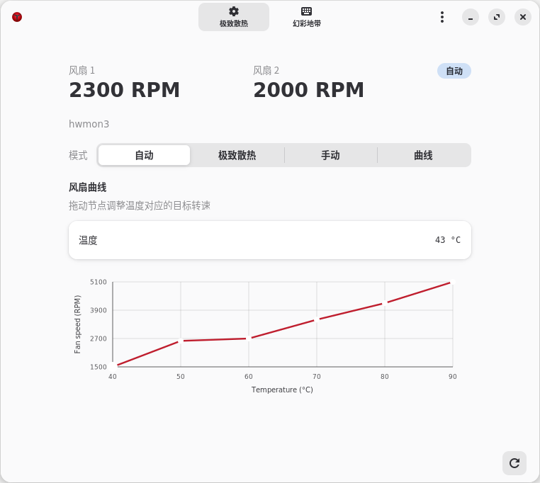
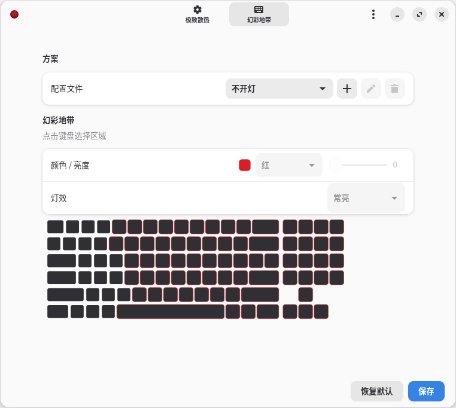

# Y720 Nerve Linux

[English README](README.md)

联想 Y720-15IKB 的 Linux 风扇、功能键和四区背光工具，版本 0.1.1。
仅支持 LENOVO 80Y4 / Y720-15IKB / BIOS 4GCN38WW / x86_64。

该项目由AI完成。

## 功能与原理

- `y720_cooling`：保留原厂 auto/boost，提供标准 hwmon 联动调速；自定义曲线通过
  Linux thermal 的 `step_wise` 调节器执行。
- `y720_hid`：补充功能键事件。
- `y720-fan`、`y720-backlight`：两个独立 CLI。
- `y720-control`：GTK4/libadwaita GUI，异步调用 CLI，负责配置、显示和快捷键，
  不直接访问硬件端口，也不充当曲线守护进程。

两个风扇共享一个 1500–5100 RPM 目标，不能独立调速或停转。
`pwm1` 是归一化请求，不是电气占空比。外部 fancontrol、CoolerControl 等 hwmon
软件可独立控制；直接写 hwmon 目标会释放内核曲线控制权，不要同时接管。

曲线使用一个内核控制温度，直接读取 Linux thermal 的 `x86_pkg_temp`。
它实际来自 CPU 封装，不是整机最高温度，也不保证反映独显单独高负载。
无需用户态采样服务，不调用 NVIDIA 工具或读取独显电源状态。
5100 RPM 随时可由曲线请求，不以过热为条件。控制温度缺失或通信失败时保留最后目标、
报告错误并重试，不自动切 auto/boost 或固定全速。卸载、关机和休眠请求交回固件 auto，
唤醒后恢复原曲线；硬件失联或内核崩溃时不能保证恢复。

背光由用户态通过独立 hidraw 接口提交固定调色板、五种灯效和四区亮度。
没有可靠的颜色/亮度读回，“已提交”和保存方案都不代表硬件读回状态。

## 界面截图





## 安装与卸载

先以普通用户构建。GUI 需要 GTK 4.16+、libadwaita 1.7+；模块必须使用与当前内核
匹配的 headers 和工具链。

```sh
# Debian 13
sudo apt install build-essential meson ninja-build pkg-config python3 dpkg-dev \
  libgtk-4-dev libadwaita-1-dev libjson-glib-dev libgdk-pixbuf-2.0-dev \
  libx11-dev dkms
make
make gui
sudo ./install.sh
```

源码安装默认前缀 `/usr/local`，可选 `--cli`、`--gui`、`--drivers`。
自定义前缀须同时用于构建和安装，例如 `make gui PREFIX=/opt/y720`、
`sudo ./install.sh --prefix /opt/y720`。安装不主动加载模块、接管硬件或设置自启动；
HID alias 可在设备出现时自动绑定。

```sh
./scripts/build-debs.sh
sudo apt install ./dist/y720-control_*.deb ./dist/y720-cooling-dkms_*.deb ./dist/y720-hid-dkms_*.deb
```

建议在目标发行版构建；

源码卸载：先选择 auto，再运行 `sudo ./uninstall.sh --all`，或按组件卸载。
卸载器保留个人配置，拒绝删除被修改或来源不明的文件。deb 包用 apt 卸载；
不要混用两种方式管理相同文件。源码升级前使用旧版卸载器移除旧文件。

## 使用

```sh
sudo modprobe y720_cooling                 # 默认只读
# 若已加载，先安全卸载再开放控制；重复 modprobe 不会修改参数
sudo modprobe -r y720_cooling
sudo modprobe y720_cooling allow_control=1
y720-fan --json status
sudo y720-fan mode auto
sudo y720-fan mode boost
sudo y720-fan set --rpm 4000
printf '1500 1800 2400 3200 4200 5100\n' | sudo y720-fan curve apply -
y720-control
y720-backlight --json status
sudo y720-backlight set --colors red blue green white --levels 0 1 2 3
```

曲线需要 `CONFIG_THERMAL_GOV_STEP_WISE` 和有效温度源。旧模块不因版本号相同
就支持新接口，详见 [CLI 手册](docs/CLI.md)。


完整 GUI 安装仅为 sudo/wheel 管理员组授予固定 CLI 命令的免密 `sudo -n`，
不放行任意 shell、文件路径或普通非管理员用户。GUI 始终普通用户运行。
专用背光和输入节点另用活动桌面会话的 uaccess 权限；SSH、非活动会话或缺少 logind
时不保证能读取按键，不需加入整个 input 组或放开所有 hidraw。

## 功能键

| 按键 | 处理 |
|---|---|
| Fn+F4 / F6 / F8 | 补充麦克风静音、触控板切换、摄像头隐私事件 |
| Fn+空格 | `KEY_KBDILLUMTOGGLE`，背光切换由用户态决定 |
| NumLock 关闭的小键盘 7 | `KEY_PROG1`，GUI 驻留时显示窗口，不隐藏或切换方案 |
| NumLock 关闭的小键盘 8 / 9 / / | 通用 HID 播放暂停、上一首、下一首映射 |
| 不带修饰键的 F22 录屏键 | `KEY_RECORD`；`map_record=0` 可禁用，带修饰键时保留 F22 |
| Fn+F7 | `radio_zero_pulse=1` 时合成飞行模式事件，默认关闭 |

小键盘功能层不需要 Fn；音量、亮度和其他标准键沿用内核通用路径。
事件识别不代表桌面已配置动作，摄像头物理断开时无法验证摄像头功能。
默认 Ctrl+Shift+主键区 0 切换 auto/boost，Fn+空格切换背光方案，保留已有自定义配置。
GUI 完全退出后的启动键可由用户自行绑定到 `y720-control`，项目不改写桌面快捷键或新增 root 服务。

普通组合键在 X11 下使用 XGrabKey，在 Wayland 下使用
[GlobalShortcuts Portal](https://flatpak.github.io/xdg-desktop-portal/docs/doc-org.freedesktop.portal.GlobalShortcuts.html)。
Wayland 需要 `xdg-desktop-portal` 和实现此接口的桌面后端；首次启用可能需要在桌面对话框中授权。
设置页显示授权结果及桌面实际分配的组合键，保存的组合键只是首选请求。
未授权或桌面不支持时会提示原因，不通过 XWayland 冒充全局支持；旧 `keycode:` 配置需重新录制。
Fn+空格和小键盘启动键在两种会话下均使用专用 evdev 节点，权限要求不变。

全局快捷键需要 GUI 运行。若桌面没有该 Portal，可自行在桌面快捷键设置中绑定
`gapplication action org.y720.Control fan-toggle` 或
`gapplication action org.y720.Control light-next`，控制已运行的 GUI。

Fn+F7 的启用、限制与回滚，以及可选 GameZone 窄修复见 [开发说明](docs/DEVELOPMENT.md)。

## 验证与许可

`make test` 覆盖纯函数、模拟 CLI、GUI 生命周期和隔离安装，不写真实硬件。
快捷键回归覆盖 Portal 授权、取消、服务断开、重复事件和退出清理；模拟测试不替代各桌面的实际按键验收。
另有显式加载、不连接真实风扇的 Linux thermal 集成测试模块。
已验证低中高档收敛及标准 hwmon 控制。原版 fancontrol 3.6.2 和 CoolerControl 5.0.1
运行过真实温度曲线，不依赖专用插件。当前单一温度方案不需要 NVIDIA 库或采样服务，
实际验收范围以本版测试为准；未完成长期满载、真实睡眠和完整受控升温/降温回归。

内核驱动和相关 C 测试为 GPL-2.0-only；CLI、GUI、脚本和文档为 MIT，另有声明除外。
保留逐文件 SPDX、版权及 GameZone 上游作者，详见 [LICENSE](LICENSE)。
仓库不分发 Lenovo Windows 驱动、BIOS 或专有固件。
